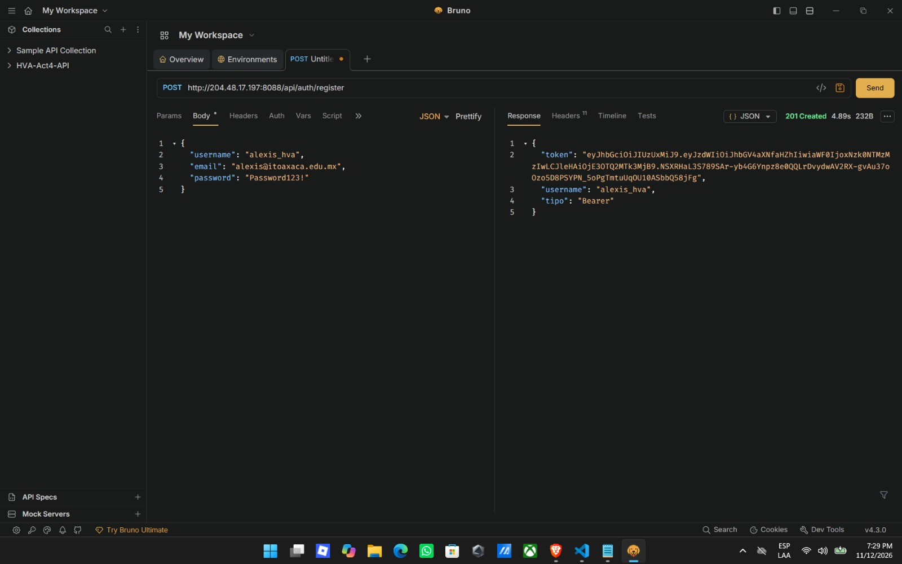
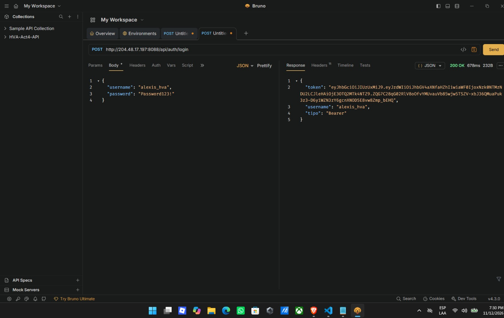
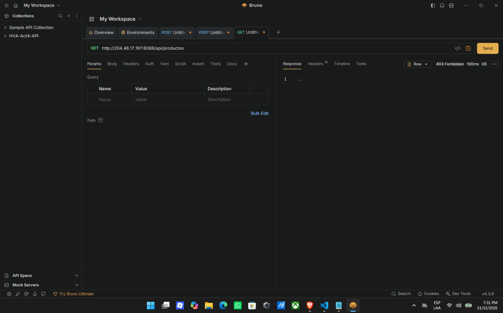
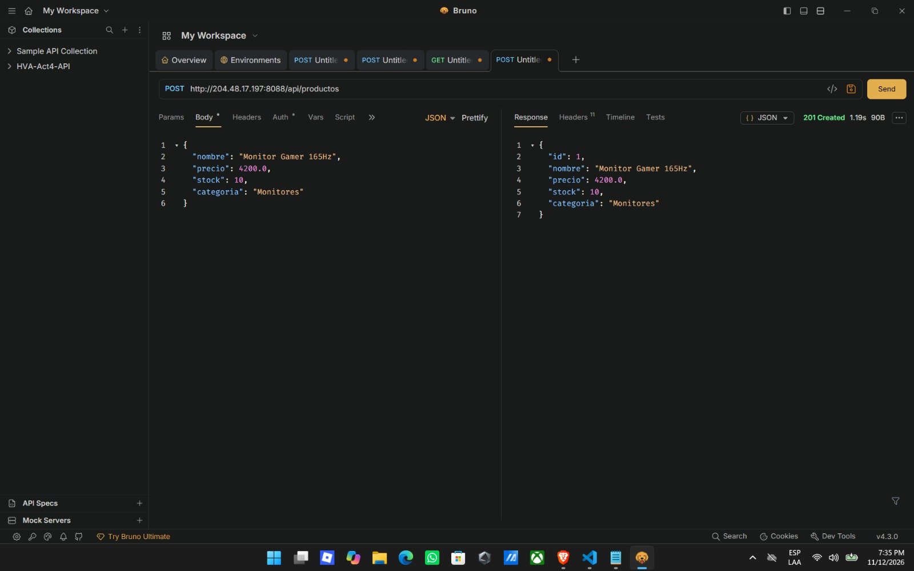
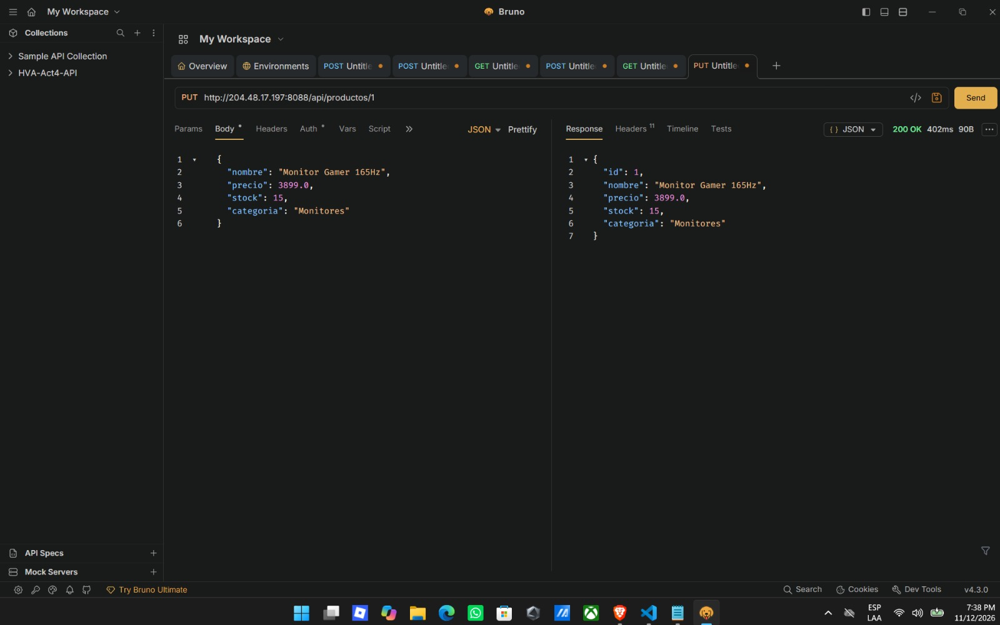
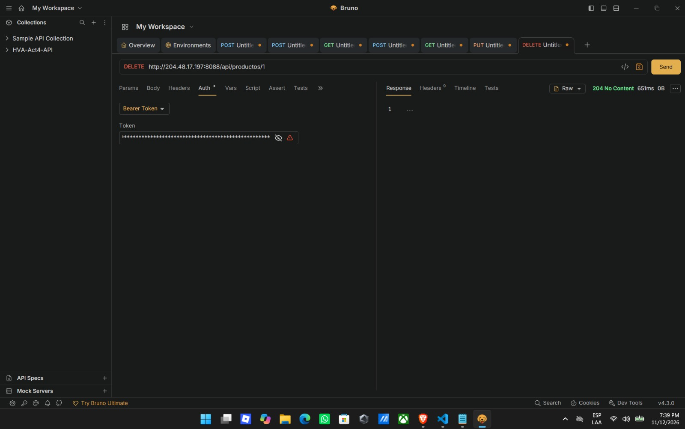
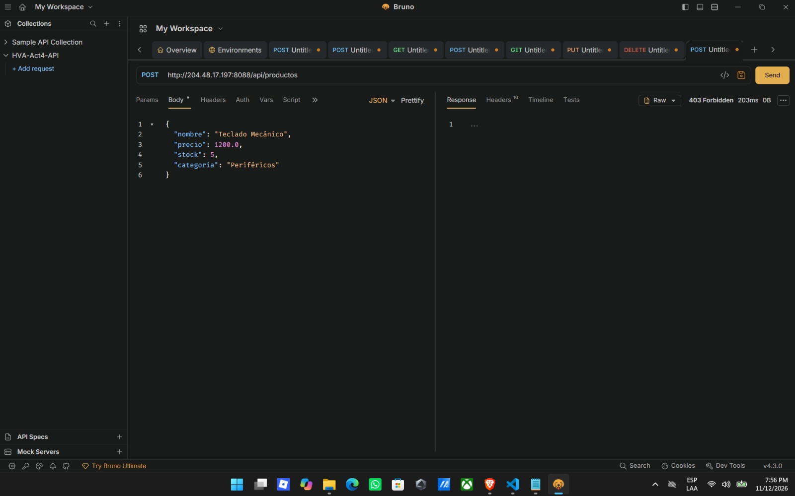
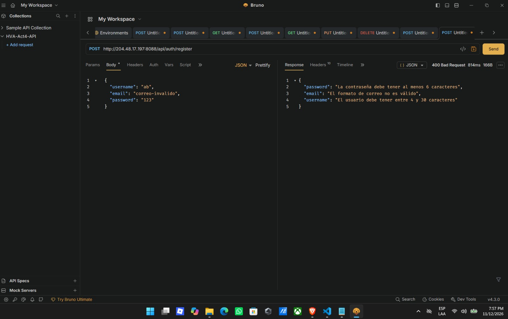
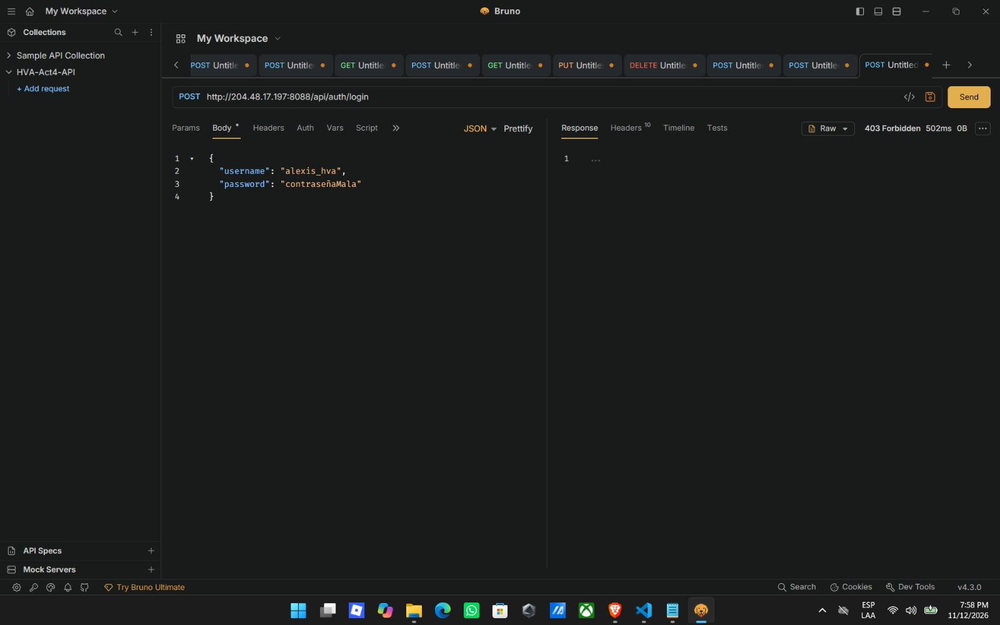

# Actividad 4: API REST Segura con Spring Security, JWT y Bean Validation

**Alumno:** Alexis Hernández Vázquez  
**Número de Control:** 23160952  
**Grupo:** 6SA  
**Institución:** Instituto Tecnológico de Oaxaca  
**Materia:** Programacion Web

---

## Descripción General del Proyecto

Este proyecto consiste en una **API REST pura** desarrollada con **Spring Boot** y conectada a **MySQL**, diseñada sin motores de plantillas ni vistas HTML (como Thymeleaf), respondiendo exclusivamente mediante estructuras **JSON** y códigos de estado HTTP estandarizados.

El objetivo principal es integrar la persistencia de datos vista en actividades previas (Entidades, Repositorios JPA, Servicios y DTOs) con una capa de **seguridad real y sin estado (*Stateless*)** utilizando **Spring Security** y **JSON Web Tokens (JWT)**. De este modo, cualquier operación de gestión sobre el catálogo de productos exige que el cliente demuestre su identidad mediante un token firmado criptográficamente.

---

## Arquitectura y Flujo de Funcionamiento

El código está organizado bajo una arquitectura limpia en capas dentro del paquete `com.ito.hva_act4_t4`:

1. **`entity` (Modelo de Dominio):** Define las tablas `usuarios` (implementando `UserDetails` de Spring Security con roles `ROLE_USER` / `ROLE_ADMIN`) y `productos` mapeadas con JPA/Hibernate.
2. **`repository` (Acceso a Datos):** Interfaces que extienden de `JpaRepository` para ejecutar operaciones CRUD, consultas de existencia (`existsByUsername`, `existsByEmail`) y paginación nativa en MySQL.
3. **`dto` (Data Transfer Objects):** Objetos dedicados (`RegisterRequest`, `LoginRequest`, `AuthResponse`, `ProductoDTO`) que aíslan la base de datos del exterior. Garantizan que datos sensibles como el hash de la contraseña nunca viajen en las respuestas JSON y aplican reglas de **Bean Validation** (`@NotBlank`, `@Email`, `@Size`, `@Positive`, `@Min`).
4. **`security` (Autenticación y Autorización):**
   * **`JwtService`:** Genera tokens firmados con HMAC-SHA (`JJWT 0.12.6`), extrae los *claims* (usuario y fecha de expiración) y verifica su integridad.
   * **`JwtAuthenticationFilter`:** Filtro que intercepta cada petición HTTP entrante antes de llegar a los controladores, lee el encabezado `Authorization: Bearer <token>` y, si es válido, registra la sesión en el `SecurityContextHolder`.
   * **`SecurityConfig`:** Configura políticas `SessionCreationPolicy.STATELESS`, deshabilita CSRF para consumo REST, encripta contraseñas con `BCryptPasswordEncoder` y establece las rutas públicas (`/api/auth/**`) frente a las protegidas.
5. **`service` (Lógica de Negocio):** Contiene las validaciones de unicidad de usuarios, encriptación de claves y transformación bidireccional entre Entidades y DTOs.
6. **`controller` (Capa REST y Manejo de Excepciones):**
   * `AuthController` y `ProductoController` exponen los endpoints devolviendo `ResponseEntity` con códigos precisos (`200`, `201`, `204`, `400`, `403`, `404`).
   * `GlobalExceptionHandler` (`@RestControllerAdvice`) captura excepciones de validación (`MethodArgumentNotValidException`) y argumentos inválidos para devolver mensajes de error claros en formato JSON.

---

## Stack Tecnológico

* **Lenguaje y Framework:** Java 17, Spring Boot 4.1.x
* **Seguridad:** Spring Security 7, JJWT (`0.12.6`), BCrypt
* **Base de Datos:** MySQL (`db_hva_act4`) con Spring Data JPA / Hibernate
* **Validación:** Jakarta Bean Validation (`@Valid`)
* **Pruebas y Documentación:** Bruno (`bruno.io`) con colección versionada en `/bruno`
* **Infraestructura:** Servidor Ubuntu VPS (DigitalOcean) ejecutando el JAR en el puerto **`8088`** con gestión optimizada de memoria JVM (`-Xms32m -Xmx96m -XX:+UseSerialGC`) para convivir sin conflictos con las Actividades 1, 2 y 3.

---

## Enlaces de Despliegue

* **Repositorio de GitHub:** `https://github.com/alexhv21/HVAact4_t4`
* **URL Base en VPS:** `http://204.48.17.197:8088`

---

## Endpoints de la API

### Autenticación (Rutas Públicas)
| Método | Endpoint | Descripción | Código Esperado |
| :--- | :--- | :--- | :--- |
| `POST` | `/api/auth/register` | Registra un nuevo usuario con contraseña encriptada (BCrypt) y devuelve su JWT | `201 Created` / `400 Bad Request` |
| `POST` | `/api/auth/login` | Autentica credenciales y genera un token Bearer válido por 24 horas | `200 OK` / `403 Forbidden` |

### Gestión de Productos (Rutas Protegidas con `Authorization: Bearer <token>`)
| Método | Endpoint | Descripción | Código Esperado |
| :--- | :--- | :--- | :--- |
| `GET` | `/api/productos?page=0&size=5` | Lista los productos de forma paginada y ordenada | `200 OK` |
| `GET` | `/api/productos/{id}` | Obtiene el detalle de un producto específico por ID | `200 OK` / `404 Not Found` |
| `POST` | `/api/productos` | Crea un nuevo producto validando los campos del DTO | `201 Created` / `400 Bad Request` |
| `PUT` | `/api/productos/{id}` | Actualiza un producto existente por su ID | `200 OK` / `404 Not Found` |
| `DELETE` | `/api/productos/{id}` | Elimina un producto de la base de datos | `204 No Content` / `404 Not Found` |

---

## Evidencias de Pruebas en Bruno

La colección completa de peticiones se encuentra versionada en la carpeta [/HVA-Act4-API](HVA-Act4-API/).

### 1. Registro de Usuario (`POST /api/auth/register` - `201 Created`)

### 2. Inicio de Sesión y Generación de JWT (`POST /api/auth/login` - `200 OK`)

### 3. Rechazo de Petición GET sin Token (`GET /api/productos` - `403 Forbidden`)

### 4. Creación de Producto con Token (`POST /api/productos` - `201 Created`)

### 5. Listado Paginado de Productos (`GET /api/productos?page=0&size=5` - `200 OK`)

### 6. Actualización de Producto (`PUT /api/productos/1` - `200 OK`)

### 7. Eliminación de Producto (`DELETE /api/productos/1` - `204 No Content`)

### 8. Validación de Datos de Entrada Fallida (`POST /api/auth/register` - `400 Bad Request`)
Comprobación de `@Valid` y `GlobalExceptionHandler` rechazando formato de correo inválido, usuario corto y contraseña menor a 6 caracteres:

### 9. Rechazo de Credenciales Inválidas (`POST /api/auth/login` - `403 Forbidden`)
Intento de inicio de sesión con contraseña incorrecta bloqueado por Spring Security:

### 10. Rechazo de Creación POST sin Token (`POST /api/productos` - `403 Forbidden`)
Intento de insertar un registro en un endpoint protegido sin encabezado `Authorization`:
